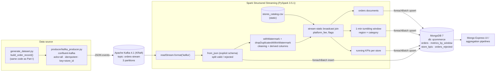
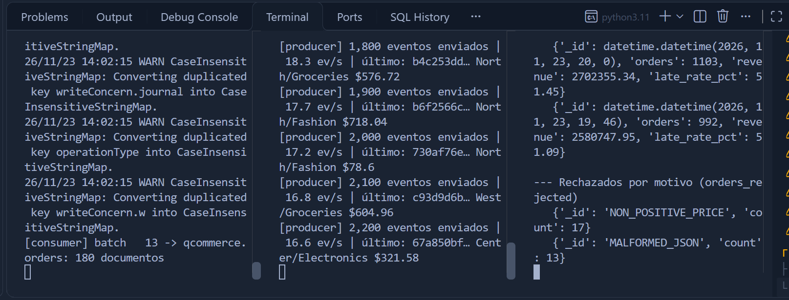
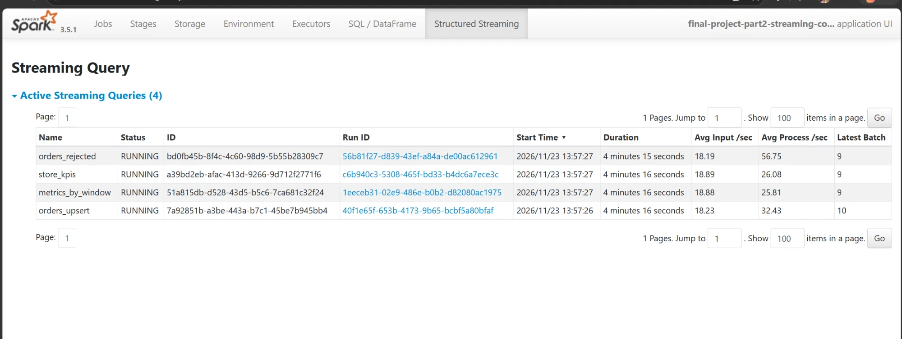
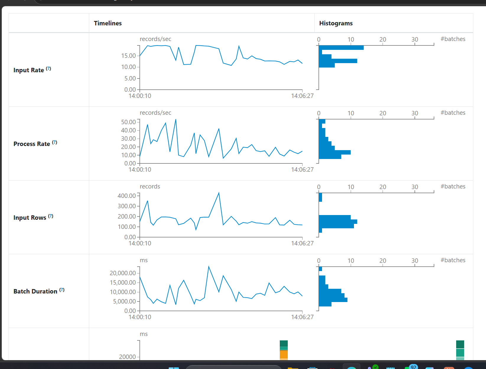
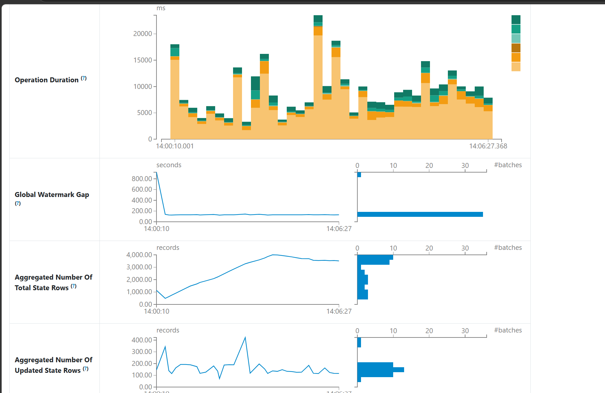
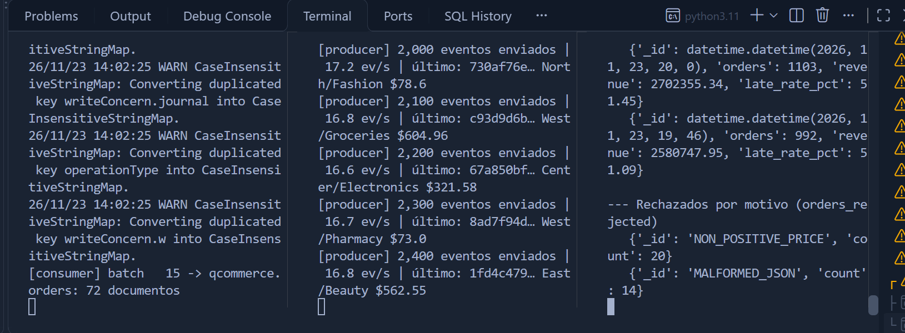
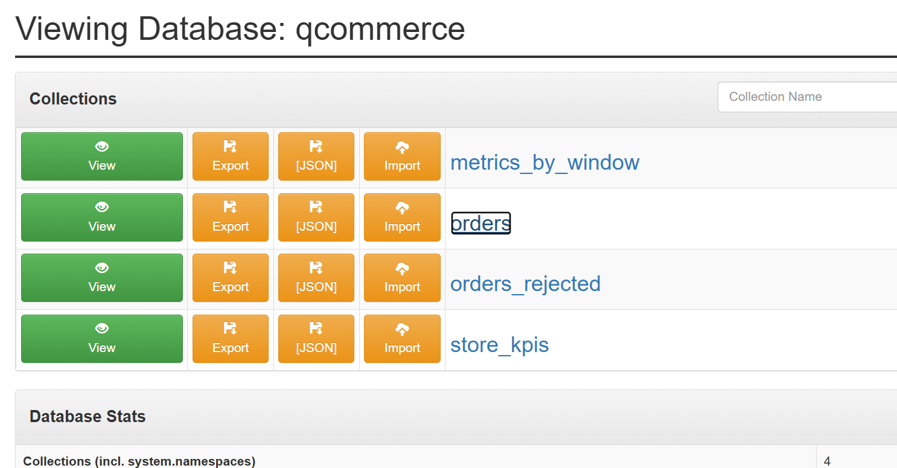
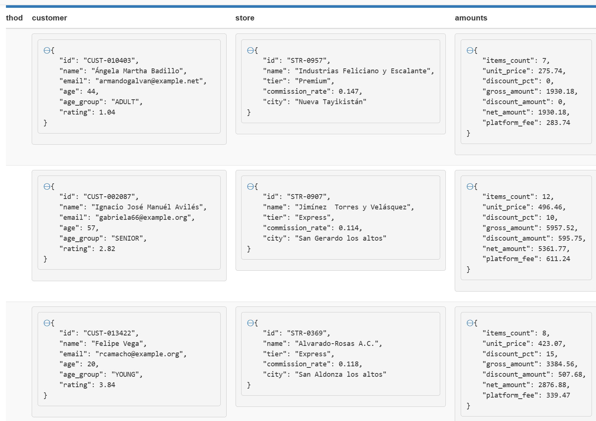
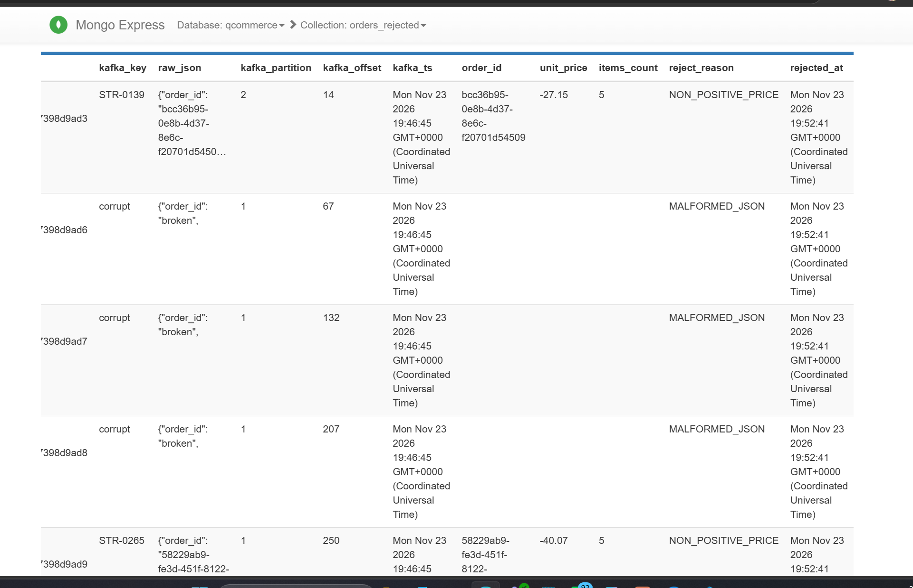

# Big Data Engineering — Final Project, Part II
## Structured Streaming with PySpark, Kafka and MongoDB

**ITESO — Procesamiento de Datos Masivos**

| Team member | Student ID |
|---|---|
| Ximena Gonzales Guerra | `<ID>` |
| Renata Caballero Velazquez | `<ID>` |

Repository: `https://github.com/Xixigv/ProyectoDM` · Pull Request: `<PR link>`

---

## 1. Introduction

### 1.1 Problem statement and data

Part I built a batch pipeline over a ≥30 GB synthetic dataset of **quick-commerce orders**
(Faker generator → S3 → Spark on EMR → partitioned Parquet). In Part II the same business
events arrive **continuously**: every time a customer places an order, an event is published to
Kafka, and a Spark Structured Streaming application cleans, enriches and aggregates it in near
real time, persisting the results in MongoDB so operations dashboards can query them while the
stream is running.

Each event has exactly the schema used in Part I (one JSON object per order):

| Field | Type | Description |
|---|---|---|
| `order_id` | string (UUID) | Order identifier (~0.5% intentional duplicates) |
| `event_timestamp` | string (ISO-8601, UTC) | When the order happened (event time) |
| `customer_id`, `customer_name`, `customer_email` | string | Customer data (Faker) |
| `customer_age` | int, nullable | Customer age (~3% nulls) |
| `store_id` | string | FK to `stores_catalog.csv` (`STR-0001`…`STR-1000`) |
| `city` | string, nullable | Delivery city (nulls and untrimmed values on purpose) |
| `country_region` | string | North, South, Center, West, East |
| `product_category` | string | Electronics, Groceries, Pharmacy, Fashion, Home, Beauty |
| `payment_method` | string | Credit Card, Debit Card, Cash, Digital Wallet |
| `items_count` | int | 1–12 |
| `unit_price` | double | 5–850 (~0.5% negative on purpose) |
| `discount_pct` | double | 0, 5, 10, 15, 20 |
| `delivery_time_min`, `distance_km` | double | Delivery metrics |
| `customer_rating` | double, nullable | 1–5 (~4% nulls) |
| `order_status` | string | DELIVERED, RETURNED, CANCELLED |
| `notes` | string | Free text |

### 1.2 Architecture



> Export this diagram as an image for the PDF (paste the block into https://mermaid.live).

### 1.3 Technologies and rationale

| Technology | Role | Why |
|---|---|---|
| **Apache Kafka 4.1 (KRaft)** | Durable, partitioned event log | Decouples producer and consumer, replayable (offsets), standard Spark source. KRaft removes ZooKeeper. |
| **confluent-kafka (Python)** | Producer client | librdkafka-based, supports idempotence, `acks=all`, compression and delivery callbacks. |
| **PySpark 3.5.1 Structured Streaming** | Stream processing | Same DataFrame API as Part I, so the batch transformations are reused; exactly-once with checkpoints; watermarks and windowed state. |
| **MongoDB 7 + mongo-spark-connector 10.4** | Sink | See below. |
| **Docker Compose** | Local infrastructure | Reproducible Kafka + MongoDB + UI with one command. |

**Why MongoDB instead of Neo4j.** Our data is an *event/document* problem, not a *relationship*
problem: each order is a self-contained record that is naturally represented as one document with
embedded sub-documents (`customer`, `store`, `amounts`, `delivery`, `kafka`). The queries we need
(revenue per region, per-window metrics, top stores) are aggregations, which MongoDB's
aggregation pipeline handles natively. MongoDB also supports idempotent **upserts by `_id`**,
which is exactly what a streaming sink needs to tolerate micro-batch replays after a failure, and
its flexible schema (enforced with a `$jsonSchema` validator) lets us evolve fields without
migrations. A graph database would add value only if we traversed relationships such as
customer → store → customer recommendations, which is out of scope.

---

## 2. Producer Application

File: [`producer/kafka_producer.py`](../producer/kafka_producer.py) — PR: `<PR link>`

**Same information as Part I.** The record-building logic of `generate_dataset.py` was refactored
into a single function, `build_order_record()`, which is now used by **both** the batch generator
(Part I, writes `.jsonl` files to S3) and the Kafka producer (Part II, one JSON message per event).
We verified the refactor is behaviour-preserving: the batch generator produces byte-identical
files before and after the change. The store catalog is regenerated with the same seed (42), so
`store_id`s match the catalog used in EMR.

Main features:

- **Topic management:** creates `orders-stream` with 3 partitions if it does not exist.
- **Message key = `store_id`:** all events of a store go to the same partition (per-store ordering).
- **Reliability:** `acks=all`, `enable.idempotence=true`, delivery callback counting successes/errors,
  `flush()` on exit, clean `Ctrl+C` handling.
- **Throughput:** `linger.ms=20` + `lz4` compression; configurable rate (`--rate`, events/s) and
  size (`--max-events`).
- **Event time:** in `synthetic` mode `event_timestamp` is set to the current UTC time so windowed
  aggregations are meaningful live. In `replay` mode the producer re-emits the `.jsonl` files from
  Part I as-is.
- **Data-quality testing:** `--corrupt-every N` injects a malformed JSON message every N events;
  the Part I generator already injects duplicates, nulls and negative prices.

Run:

```bash
python producer/kafka_producer.py --rate 20 --corrupt-every 200
```

*Figure 2.1 — Producer (middle pane) sending ~17 events/s to `orders-stream`, running at the same
time as the consumer (left) and the MongoDB validation script (right).*



---

## 3. Consumer Application

File: [`consumer/streaming_consumer.py`](../consumer/streaming_consumer.py)

The consumer is a single streaming DataFrame that keeps growing, with four streaming queries
attached to it:

1. **Source:** `spark.readStream.format("kafka")` with `subscribe=orders-stream`,
   `startingOffsets=earliest` and `maxOffsetsPerTrigger=2000` (backpressure).
2. **Safe parsing:** `CAST(value AS STRING)` → `from_json` with the **same explicit schema as
   Part I** (`SparkUtils.generate_schema`). Malformed JSON never crashes the query; it yields
   nulls.
3. **Validation / quarantine:** each row gets a `reject_reason` (`MALFORMED_JSON`,
   `INVALID_TIMESTAMP`, `NON_POSITIVE_PRICE`, `NON_POSITIVE_ITEMS`). Rejected rows are written to
   `orders_rejected`; valid rows continue.
4. **Cleaning (Part I logic):** `withWatermark("event_ts", "2 minutes")` +
   `dropDuplicatesWithinWatermark(["order_id"])` (bounded-state deduplication), `trim(city)`,
   `fillna` for city/rating/age.
5. **Column derivation:** `gross_amount`, `net_amount`, `discount_amount`, `delivery_sla`
   (FAST/ON_TIME/LATE), `age_group`, `speed_kmh`, `processing_lag_sec` (Kafka ingest time − event
   time).
6. **Stream-static join:** broadcast join with `stores_catalog.csv` → `store_name`, `store_tier`,
   `commission_rate`, and derived `platform_fee`.
7. **Outputs:**
   - **orders** (`append`): one nested document per order.
   - **metrics_by_window** (`update`): 1-minute **tumbling windows** by region × category with
     orders, revenue, avg ticket, platform fees, avg delivery time, avg rating, cancel rate, late
     rate and approx. distinct customers. The watermark lets Spark drop old window state.
   - **store_kpis** (`update`): running KPIs per store (bounded state: 1,000 keys).
   - **orders_rejected** (`append`): quarantined messages with their raw JSON.

Fault tolerance: each query has its own checkpoint directory, so offsets and state are recovered
after a restart; MongoDB writes are upserts by `_id`, making replays idempotent (end-to-end
effectively-once).

Run:

```bash
python consumer/streaming_consumer.py
```

*Figure 3.1 — Spark UI, Structured Streaming tab: the four streaming queries running concurrently
(`orders_upsert`, `metrics_by_window`, `store_kpis`, `orders_rejected`).*



*Figure 3.2 — Input rate, process rate, input rows per micro-batch and batch duration.*



*Figure 3.3 — Operation duration, global watermark gap (stabilises at ~2 minutes, the configured
watermark) and stateful-operator rows: state grows and is then evicted as the watermark advances.*



*Figure 3.4 — Consumer terminal (left) writing micro-batches to `qcommerce.orders`, while the
producer keeps sending (middle).*



---

## 4. Data Persistence (MongoDB)

### 4.1 Collection schema

Defined and enforced with a `$jsonSchema` validator in
[`mongo/init_collections.py`](../mongo/init_collections.py), plus indexes.

**`orders`** (`_id` = `order_id`):

```json
{
  "_id": "3f2b…", "order_id": "3f2b…",
  "event_ts": ISODate, "order_date": ISODate, "order_status": "DELIVERED",
  "country_region": "West", "product_category": "Groceries", "payment_method": "Cash",
  "customer": { "id": "CUST-001234", "name": "…", "email": "…", "age": 34, "age_group": "ADULT", "rating": 4.2 },
  "store":    { "id": "STR-0042", "name": "…", "tier": "Premium", "commission_rate": 0.15, "city": "…" },
  "amounts":  { "items_count": 3, "unit_price": 120.5, "discount_pct": 10, "gross_amount": 361.5,
                "discount_amount": 36.15, "net_amount": 325.35, "platform_fee": 48.8 },
  "delivery": { "time_min": 23.4, "distance_km": 5.1, "speed_kmh": 13.08, "sla": "ON_TIME" },
  "kafka":    { "partition": 1, "offset": 5321, "ingested_at": ISODate, "processing_lag_sec": 0.02 },
  "notes": "…"
}
```

**`metrics_by_window`** (`_id` = `"<window_start>|<region>|<category>"`): `window_start`,
`window_end`, `country_region`, `product_category`, `total_orders`, `total_revenue`, `avg_ticket`,
`total_platform_fees`, `avg_delivery_min`, `avg_rating`, `cancel_rate_pct`, `late_rate_pct`,
`unique_customers`, `updated_at`.

**`store_kpis`** (`_id` = `store_id`): `store_name`, `store_tier`, `total_orders`,
`total_revenue`, `total_platform_fees`, `avg_rating`, `cancelled_orders`, `returned_orders`,
`last_order_at`, `updated_at`.

**`orders_rejected`**: `raw_json`, `reject_reason`, Kafka coordinates, `rejected_at`.

### 4.2 Connector, upserts and write concern

Each query uses `foreachBatch` and the **mongo-spark-connector 10.4** (`format("mongodb")`):

```python
batch_df.write.format("mongodb").mode("append") \
    .option("connection.uri", MONGODB_URI) \
    .option("database", "qcommerce").option("collection", collection) \
    .option("operationType", "replace").option("upsertDocument", "true") \
    .option("idFieldList", "_id") \
    .option("writeConcern.w", "majority") \
    .option("writeConcern.journal", "true") \
    .option("writeConcern.wTimeoutMS", "10000") \
    .save()
```

- `operationType=replace` + `upsertDocument=true` → **upsert** by `_id`.
- **Write concern** `w=majority, j=true`: a write is acknowledged only after it is journaled on a
  majority of replica-set members, so acknowledged results survive a node crash.

### 4.3 Credential management

No credentials are in the code. `MONGODB_URI`, `MONGODB_DATABASE`, `KAFKA_BOOTSTRAP_SERVERS` and
`KAFKA_TOPIC` are read from environment variables or from a local `.env` file, which is listed in
`.gitignore`; the repository only contains `.env.example` with placeholder values. The same
variables feed `docker-compose.yml` (MongoDB root user). In production (e.g. EMR) they would come
from AWS Secrets Manager or the step's environment.

### 4.4 Validation queries

[`mongo/validate_queries.py`](../mongo/validate_queries.py) runs aggregation pipelines over the
persisted data; e.g. revenue and cancellation rate per region:

```javascript
db.orders.aggregate([
  { $group: { _id: "$country_region", orders: { $sum: 1 },
              revenue: { $sum: "$amounts.net_amount" },
              cancelled: { $sum: { $cond: [{ $eq: ["$order_status", "CANCELLED"] }, 1, 0] } } } },
  { $project: { orders: 1, revenue: { $round: ["$revenue", 2] },
                cancel_rate_pct: { $round: [{ $multiply: [{ $divide: ["$cancelled", "$orders"] }, 100] }, 2] } } },
  { $sort: { revenue: -1 } }
])
```

*Figure 4.1 — Output of `python mongo/validate_queries.py --watch 5` (right pane in Figures 2.1 and
3.4): per-window totals and rejected messages by reason grow between refreshes
(`NON_POSITIVE_PRICE` 17 → 20, `MALFORMED_JSON` 13 → 14), proving records are persisted in real
time.*

*Figure 4.2 — Mongo Express: the four collections of the `qcommerce` database.*



*Figure 4.3 — `orders` documents with the embedded `customer`, `store` and `amounts`
sub-documents.*



*Figure 4.4 — `orders_rejected`: malformed JSON and negative-price events quarantined with their raw
payload and Kafka coordinates; the pipeline never crashed.*



---

## 5. Presentation (live demo agenda)

1. `docker compose up -d` → show Kafka, MongoDB and Mongo Express running.
2. Start the **consumer** (`python consumer/streaming_consumer.py --reset`).
3. Start the **producer** (`python producer/kafka_producer.py --rate 20 --corrupt-every 200`).
4. Show both terminals working at the same time (producer counters, consumer micro-batches).
5. In a third terminal, `python mongo/validate_queries.py --watch 5`: counts and aggregations grow
   in real time; refresh Mongo Express to see new documents.
6. Show `orders_rejected` with the corrupt messages (pipeline did not crash).
7. Stop and restart the consumer to show checkpoint recovery (no duplicates thanks to upserts).
